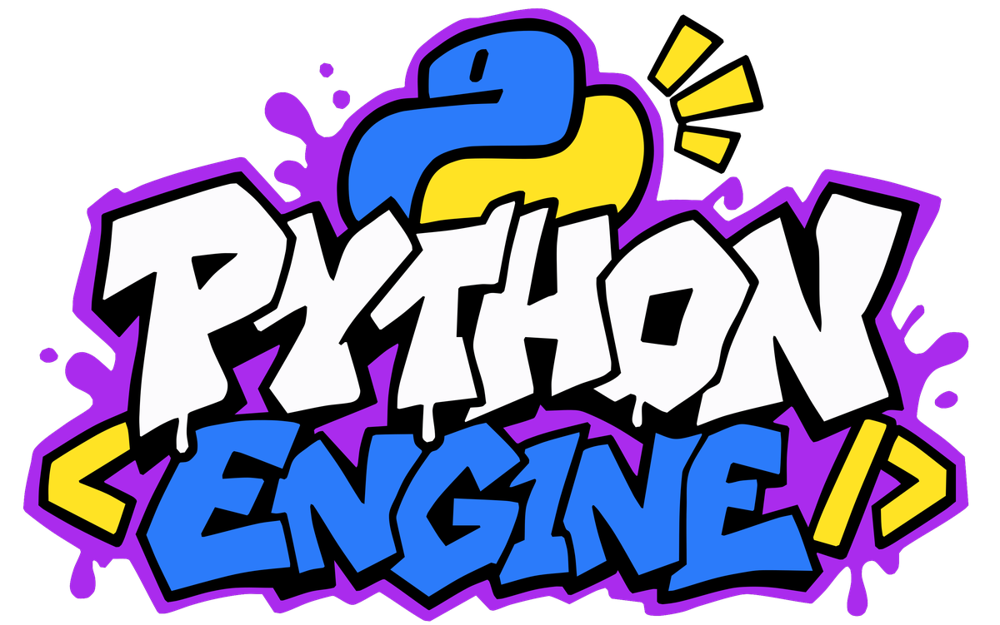
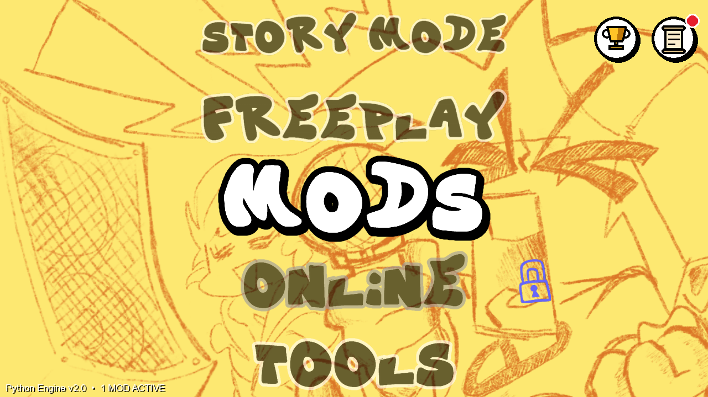
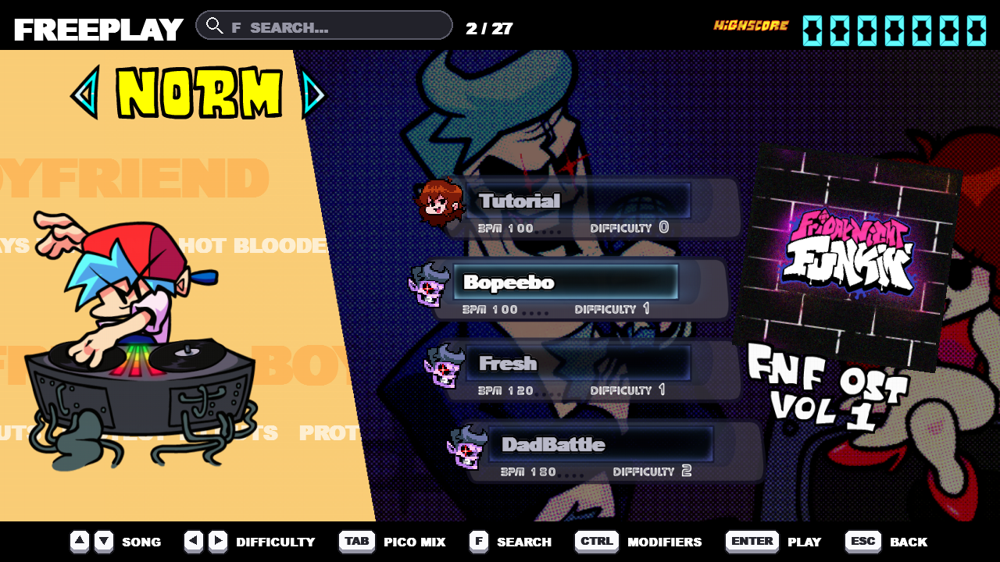
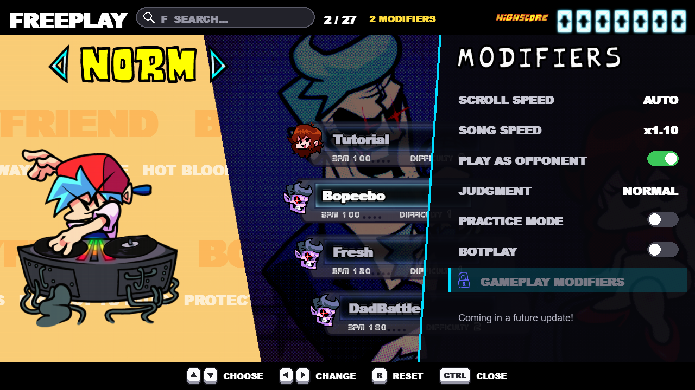
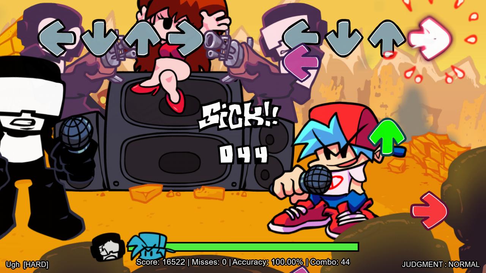
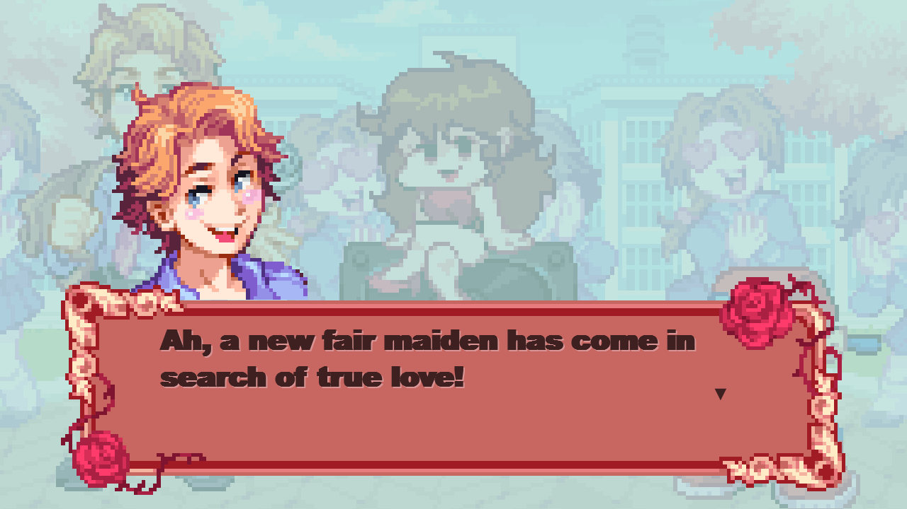
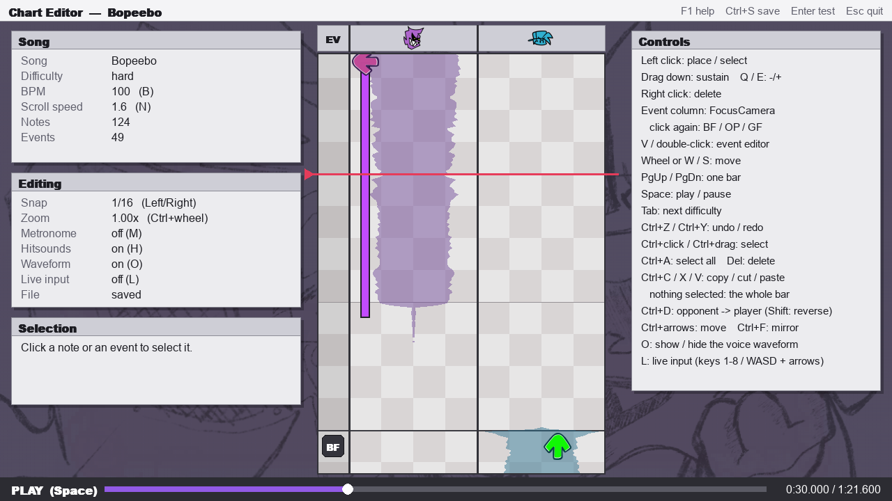
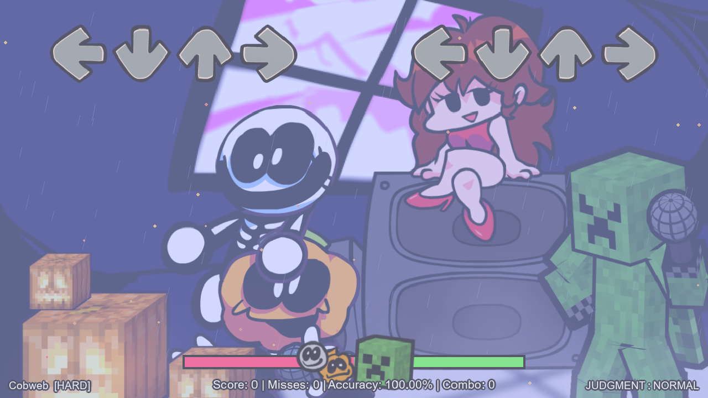
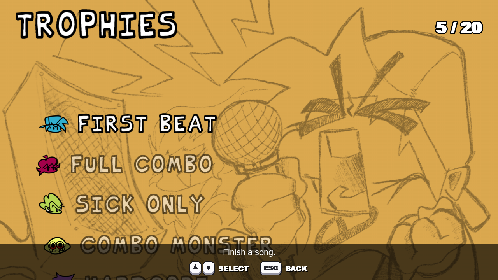
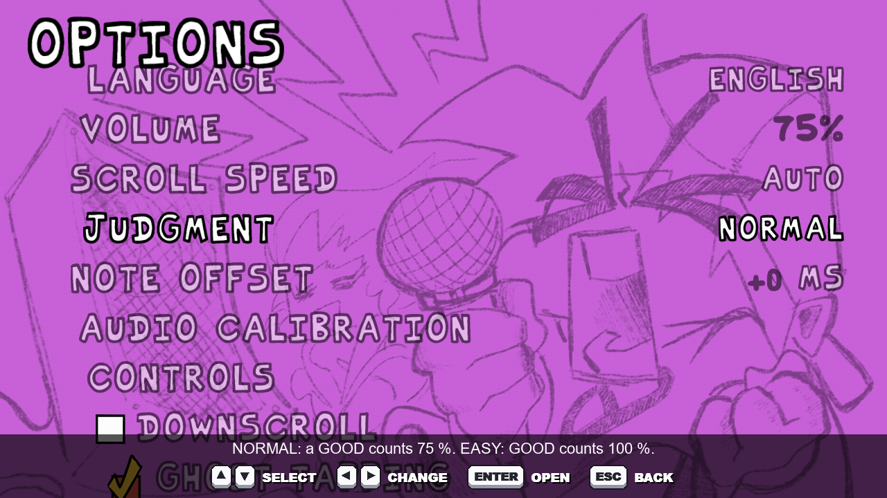

<p align="center"></p>

# FNF Python Engine

A Friday Night Funkin' engine written in **Python** with pygame. It reads the data and assets of Friday Night Funkin' (V-Slice charts, Sparrow spritesheets, Adobe Animate atlases, stages, weeks) and plays them natively, without Haxe or `Funkin.exe`.

This engine was created for my YouTube video: [https://www.youtube.com/watch?v=a-KVglrxrRQ](https://www.youtube.com/watch?v=a-KVglrxrRQ)

**Current version: 2.0.0**. Download the ready-to-play Windows build from the [Releases](https://github.com/DJCreeperYTB/FNF-Python-Engine/releases) page.



## What's new in V2.0

- **Mods**: put folders or `.zip` files in `mods/`, turn them on in the MODS menu. A mod replaces any file of the base game or adds songs, weeks, characters, stages, dialogues, trophies and note styles, and can contain **Python scripts**.
- **Example mod** (`mods/ExampleMod.zip`): *Halloween Night*, a custom week with three songs against Spooky Kids and Lemon Monster, DJCreeper as the player, dialogues, a video cutscene, Nightmare remixes and Dadbattle-style effects.
- **Modding guide** (PDF, in `mods/`): every file of a mod explained.
- **Tools**: chart editor (notes, sustains, camera events, test from the cursor), stage and camera editor, character editor. Press `7` during a song to open the chart editor on it.
- **Chart editor upgrades**: a long note goes to the end of the cell under the mouse, multiple selection (`Ctrl`+click, `Ctrl`+drag, `Ctrl+A`), copy / cut / paste (`Ctrl+C` / `X` / `V`), copy to the other side (`Ctrl+D`), move (`Ctrl`+arrows), mirror (`Ctrl+F`), redo (`Ctrl+Y`), voice waveforms (`O`), a clickable playback bar, live keyboard input (`L`, a held key makes a long note), interface sounds and a deeper metronome, help (`F1`).
- **Event panel** (`V` or double-click): list of events and adjustable fields; a mod adds its own with `data/events/<name>.json`.
- **HELP screen** (TOOLS > HELP, `H` in MODS, `F1` in the chart editor): opens the PDF guide at the right page for your problem.
- **Engine**: native events `ZoomCamera`, `SetCameraBop`, `FlashScreen`, `ShakeCamera`, `ChangeStage` (change the stage mid-song) (on top of `FocusCamera`, `PlayAnimation`, `ScrollSpeed`, `SetHealthIcon`); the camera and the interface bump to the beat like the official game (CAMERA ZOOMS option); the official mouse cursor; song speed up to x4.
- **Subtitles** in FR / EN during songs and cutscenes (`subtitles.json`, `Subtitle` event, `game.show_subtitle`): font, size, color, opacity, background, outline and position can be set.
- **Script API**: `game.camera_zoom`, `bop_rate`, `flash_screen`, `shake_camera`, `strum_offset`, `strum_alpha`, `note.alpha`, `lane_for_key`, and a per-character `death` field (game over sound and music).
- **Trophies**: 15 trophies inspired by Psych Engine, with an in-game notification. Mods can add their own.
- **Freeplay**: songs in the order of the weeks, mod songs at the bottom, search bar, Pico Mix with `Tab`, album art, DJ Boyfriend and a music preview.
- **Modifiers menu** (`Ctrl` on a song): scroll speed, song speed (up to x4), play as the opponent, judgment level, practice mode and botplay.
- **Dialogues** of Week 6 (V-Slice format) and **video cutscenes** in Story Mode, with subtitles, hold-to-skip and a child mode.
- **Options**: English/French (dialogues included), volume, one fixed scroll speed for every chart (AUTO keeps each song's speed), note delay and calibration, downscroll, ghost tapping, hitsounds and their volume, flashing lights, FPS limit, display quality, fullscreen (`F11`), CLEAR DATA (asks first), remappable keys.
- **Main menu**: a DONATE button, ONLINE (locked, coming later), trophy and news icons with in-game announcements, and an update check on GitHub.
- **Controls**: keyboard and controllers (Xbox, PlayStation, Switch); every key and button can be changed in an FNF-style Controls screen.
- **Audio calibration** with the official latency arrows and Boyfriend's voice on every beat.
- **Results screens** of Boyfriend and Pico for every rank, and one results screen at the end of a week in Story Mode.
- **Stages like the original**: Nene sits on her A-Bot speaker with a working sound visualizer (Otis and every Nene of the Pico Mixes too), Darnell's paint cans, random lightning in Week 2, Tankman's soldiers running and shot in Stress.
- Official-style game over screen and a results screen with saved records.
- **Coming later**: multiplayer and the "Gameplay Modifiers" entry (both locked in the menu for now).

| | |
|---|---|
|  |  |
|  |  |
|  |  |
|  |  |

*All screenshots were taken with V2.0.0. The previous version, with its own screenshot, is in the [v1.0.0 release](https://github.com/DJCreeperYTB/FNF-Python-Engine/releases/tag/v1.0.0).*

## Fixes since V1

- Characters: stable anchor (no more jumps or size changes between frames), offsets, `frameIndices`, dancing on the beat, Boyfriend facing the right way, special poses played to the end.
- Adobe Animate atlases drawn with the real matrix (rotation, flip, skew) and color effects: the faces of Mommy Mearest and the parents are correct.
- The camera follows the singing character (`FocusCamera` events), so the stages fill the screen.
- Tutorial no longer shows GF twice; Blazin' has its combat (Python script); animated stages.
- Opponent and player arrows light up, opponent hold notes are visible, pixel arrows and popups for Week 6.
- Inputs judged at the exact time of the key press; pause during the countdown fixed; countdown follows the BPM.
- Sparrow XML read like in the game (the alphabet no longer crashes), "packer" format (Spirit), long-format Animate atlases.
- Characters, Animate atlases and props placed with the rules of the official game (global offsets, whole-timeline bounds, Animate stage matrix, animation offsets scaled): no more floating characters in the Pico Mixes, Darnell and Spirit fixed.
- Cutscene sound on 4-channel or surround sound cards: no more sped-up sound or silence.
- Faster example mod (about 40% less time per frame).

## Play

1. Download `FNF-Python-Engine-v2.0.0-Windows.zip` from the latest release.
2. Extract it anywhere.
3. Run `FNF Python.exe`.

## Run from source

```powershell
python -m pip install -r requirements.txt
python main.py
```

The source code does not include the game assets. Put a `fnf_assets/` folder next to `main.py` containing the `assets/` folder of your Friday Night Funkin' copy, with the content of `assets/preload/` placed at the root of `fnf_assets/`.

## Controls

- Menus: arrow keys or `WASD`, `Enter` to confirm, `Escape` to go back
- Gameplay: `D F J K` or the arrow keys (remappable in `Options > Controls`)
- In game: `R` restarts the song, `Escape` pauses, `7` opens the chart editor
- Results: `Enter` continue, `R` retry, `Escape` menu

Settings, records, trophies and disabled mods are saved in `%APPDATA%\FNF Python\settings.json`.

## Build the executable

```powershell
python -m pip install pyinstaller
powershell -ExecutionPolicy Bypass -File .\build-exe.ps1
```

Result: `dist/FNF Python/FNF Python.exe`, with the `mods/` folder (example mod and PDF guide) next to it.

## Project layout

- `main.py`: entry point
- `pyfnf/game.py`: gameplay (PlayState), game over, results, application
- `pyfnf/menus.py`: title, main menu, story mode, freeplay, mods, trophies, options
- `pyfnf/editors.py`: chart, stage/camera and character editors
- `pyfnf/stage.py`: animated sprites, characters, stages, camera
- `pyfnf/assets.py`: Sparrow, packer and Adobe Animate loaders, mod overlay
- `pyfnf/data.py`: songs, weeks, charts
- `pyfnf/mods.py`: mod discovery, `.zip`, Python scripts
- `mods_src/ExampleMod/`: source of the example mod; `tools/`: scripts that build it

## Bugs and ideas

Found a bug or have an idea for a change? Please create an issue: [github.com/DJCreeperYTB/FNF-Python-Engine/issues](https://github.com/DJCreeperYTB/FNF-Python-Engine/issues).

## Support

Optional: [paypal.me/djcreeperytb](https://www.paypal.me/djcreeperytb). Also check my other mod, [Vs. DJCreeper](https://gamebanana.com/mods/732063).

## Credits

- FNF Python Engine by **DJCreeperYTB**
- Friday Night Funkin' by **The Funkin' Crew**: all game assets (art, music, characters) belong to them
- Example mod music: composed with FL Studio samples, voices from the Friday Night Funkin' SoundFont

---

# FNF Python Engine (français)

Un moteur Friday Night Funkin' écrit en **Python** avec pygame. Il lit directement les données et les assets de Friday Night Funkin' (charts V-Slice, spritesheets Sparrow, atlas Adobe Animate, scènes, semaines) et les fait tourner nativement, sans Haxe ni `Funkin.exe`.

Ce moteur a été créé pour ma vidéo YouTube : [https://www.youtube.com/watch?v=a-KVglrxrRQ](https://www.youtube.com/watch?v=a-KVglrxrRQ)

**Version actuelle : 2.0.0**. Le jeu prêt à lancer pour Windows se télécharge dans les [Releases](https://github.com/DJCreeperYTB/FNF-Python-Engine/releases).

## Nouveautés de la V2.0

- **Mods** : place des dossiers ou des `.zip` dans `mods/` et active-les dans le menu MODS. Un mod remplace n'importe quel fichier du jeu de base ou ajoute chansons, semaines, personnages, scènes, dialogues, trophées et styles de notes, et peut contenir des **scripts Python**.
- **Mod d'exemple** (`mods/ExampleMod.zip`) : *Halloween Night*, une semaine de 3 chansons contre Spooky Kids et Lemon Monster, avec DJCreeper comme joueur, des dialogues, une cinématique, des remixes Nightmare et des effets façon Dadbattle.
- **Guide de modding** (PDF, dans `mods/`) : chaque fichier d'un mod expliqué.
- **Outils** : éditeur de chart (notes, notes longues, événements caméra, test depuis le curseur), éditeur de scène et caméra, éditeur de personnage. `7` en partie ouvre l'éditeur de chart sur la chanson.
- **Éditeur de chart plus complet** : une note longue va jusqu'au bout de la case sous la souris, sélection multiple (`Ctrl` + clic, `Ctrl` + glisser, `Ctrl+A`), copier / couper / coller (`Ctrl+C` / `X` / `V`), recopier de l'autre côté (`Ctrl+D`), déplacer (`Ctrl` + flèches), miroir (`Ctrl+F`), rétablir (`Ctrl+Y`), forme d'onde des voix (`O`), barre de lecture cliquable, saisie en direct au clavier (`L`, une touche tenue fait une note longue), sons d'interface et métronome plus grave, aide (`F1`).
- **Panneau d'événements** (`V` ou double-clic) : liste des événements et champs réglables ; un mod ajoute les siens avec `data/events/<nom>.json`.
- **Écran AIDE** (TOOLS > AIDE, `H` dans MODS, `F1` dans l'éditeur de chart) : ouvre le guide PDF à la bonne page selon le problème.
- **Moteur** : événements natifs `ZoomCamera`, `SetCameraBop`, `FlashScreen`, `ShakeCamera`, `ChangeStage` (changer de décor en pleine chanson) (en plus de `FocusCamera`, `PlayAnimation`, `ScrollSpeed`, `SetHealthIcon`) ; la caméra et l'interface battent la mesure comme le jeu officiel (option ZOOMS DE CAMÉRA) ; curseur de souris officiel ; vitesse de la chanson jusqu'à x4.
- **Sous-titres** FR / EN pendant les chansons et les cinématiques (`subtitles.json`, événement `Subtitle`, `game.show_subtitle`) : police, taille, couleur, opacité, fond, contour et position réglables.
- **API de script** : `game.camera_zoom`, `bop_rate`, `flash_screen`, `shake_camera`, `strum_offset`, `strum_alpha`, `note.alpha`, `lane_for_key`, et un champ `death` par personnage (son et musiques de game over).
- **Trophées** : 15 trophées façon Psych Engine, avec notification en jeu. Les mods peuvent en ajouter.
- **Freeplay** : chansons dans l'ordre des semaines, chansons de mods en bas, barre de recherche, Pico Mix avec `Tab`, image d'album, DJ Boyfriend et aperçu de la musique.
- **Menu des modificateurs** (`Ctrl` sur une chanson) : vitesse de défilement, vitesse de la chanson (jusqu'à x4), jouer l'adversaire, niveau de jugement, mode entraînement et botplay.
- **Dialogues** de la Week 6 (format V-Slice) et **cinématiques vidéo** en mode histoire, avec sous-titres, maintien pour passer et mode enfant.
- **Options** : français/anglais (dialogues compris), volume, vitesse de défilement fixe pour tous les charts (AUTO garde celle de chaque chanson), délai des notes et calibrage, notes vers le bas, appuis libres, sons de frappe et leur volume, flashs lumineux, limite de FPS, qualité d'affichage, plein écran (`F11`), EFFACER LES DONNÉES (avec confirmation), touches modifiables.
- **Menu principal** : bouton DONATE, ONLINE (verrouillé, pour plus tard), icônes des trophées et des annonces avec annonces dans le jeu, et vérification des mises à jour sur GitHub.
- **Contrôles** : clavier et manettes (Xbox, PlayStation, Switch) ; chaque touche et chaque bouton se change dans un écran Touches façon FNF.
- **Calibrage audio** avec les flèches de latence officielles et la voix de Boyfriend sur chaque temps.
- **Écrans de résultats** de Boyfriend et de Pico pour tous les rangs, et un seul écran de résultats en fin de semaine en mode histoire.
- **Décors comme dans le jeu** : Néné assise sur son enceinte A-Bot avec des barres de son qui suivent la musique (Otis et toutes les Néné des Pico Mix aussi), bombes de peinture de Darnell, éclairs au hasard dans la Week 2, soldats de Tankman qui courent et se font abattre dans Stress.
- Écran de game over façon FNF et écran de résultats avec records sauvegardés.
- **Plus tard** : le multijoueur et l'entrée « Gameplay Modifiers » (verrouillés dans le menu pour l'instant).

*Les captures plus haut ont toutes été prises avec la V2.0.0. L'ancienne version, avec sa propre capture, est dans la [release v1.0.0](https://github.com/DJCreeperYTB/FNF-Python-Engine/releases/tag/v1.0.0).*

## Corrections de la V1

- Personnages : ancrage stable (plus de saut ni de changement de taille), offsets, danse sur le rythme, poses spéciales jouées jusqu'au bout.
- Atlas Adobe Animate rendus avec la vraie matrice et les effets de couleur : visages de Mommy et des parents corrects.
- Caméra qui suit le personnage qui chante ; les décors remplissent l'écran.
- Blazin' a son combat, les notes longues de l'adversaire sont visibles, flèches pixel pour la Week 6.
- Entrées jugées au temps exact de la touche, pause et décompte réparés.
- Personnages, atlas Animate et décors placés avec les règles du jeu officiel : plus de personnages qui flottent dans les Pico Mix, Darnell et Spirit corrigés.
- Son des cinématiques sur les cartes son 4 canaux ou surround : plus de son accéléré ni de silence.
- Mod d'exemple plus fluide (environ 40 % de temps en moins par image).

## Jouer

1. Télécharge `FNF-Python-Engine-v2.0.0-Windows.zip` dans la dernière release.
2. Extrais-le où tu veux.
3. Lance `FNF Python.exe`.

## Lancer depuis le code source

```powershell
python -m pip install -r requirements.txt
python main.py
```

Le code source ne contient pas les assets du jeu : place à côté de `main.py` un dossier `fnf_assets/` qui contient le dossier `assets/` de ta copie de Friday Night Funkin', avec le contenu de `assets/preload/` à la racine de `fnf_assets/`.

## Contrôles

- Menus : flèches ou `WASD`, `Entrée` pour valider, `Échap` pour revenir
- Partie : `D F J K` ou les flèches (modifiables dans `Options > Controls`)
- En partie : `R` recommence la chanson, `Échap` met en pause, `7` ouvre l'éditeur de chart
- Résultats : `Entrée` continuer, `R` rejouer, `Échap` menu

## Bugs et idées

Un bug ou une idée de modification ? Crée une issue : [github.com/DJCreeperYTB/FNF-Python-Engine/issues](https://github.com/DJCreeperYTB/FNF-Python-Engine/issues).

## Soutien

Facultatif : [paypal.me/djcreeperytb](https://www.paypal.me/djcreeperytb). Découvre aussi mon autre mod, [Vs. DJCreeper](https://gamebanana.com/mods/732063).

## Crédits

- FNF Python Engine par **DJCreeperYTB**
- Friday Night Funkin' par **The Funkin' Crew** : tous les assets du jeu (art, musique, personnages) leur appartiennent
- Musique du mod d'exemple : composée avec des samples FL Studio, voix SoundFont de FNF
